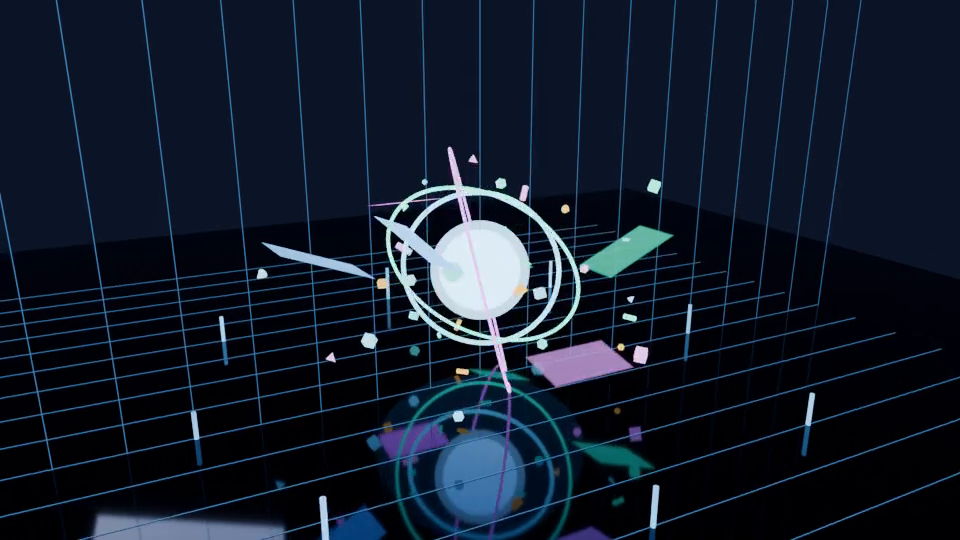

# Neon XR Spatial Interface

A stylized Blender scene of a futuristic neon environment with floating
XR style interface panels around a glowing core. The scene is designed
to look like a spatial computing space.

## What is in the scene
- Glowing core orb with an outer shell and three orbiting rings
- Neon grid floor with grid posts
- Six floating XR panels with glowing borders
- 32 animated particles
- Camera pivot that orbits the scene
- Emissive materials with point and area lights for the glow
- Keyframe animation on the orb, rings, panels, particles, and camera

## Demo
[Watch the animation](neon_xr_animation.mp4)

## Details
- Software: Blender 5.1
- Animation length: 250 frames (10 seconds)

## How to open
Download neon_xr_spatial_interface.blend, open it in Blender, and press
the spacebar to play the animation. Press F12 to render a frame.
